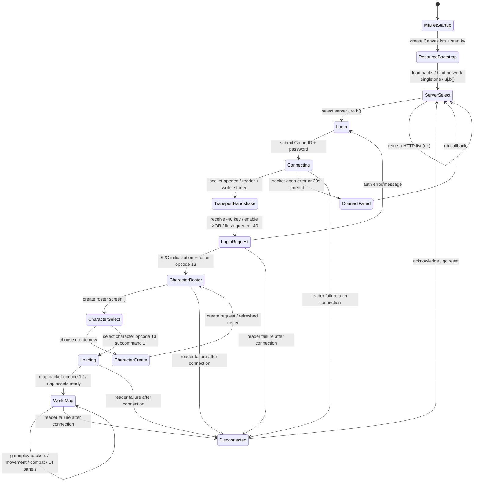

# KPAH 2.7.8 — client lifecycle và state machine

> Nguồn: CFR 0.152 source của `GameMidlet`, `km`, `kv`, `tj`, `uj`, `ro`, `rq`, `lj`, `ls`, `li`, `mj`, `acy`, `acw`, `acx`, `ka`, `qb`, `qc`. Đây là state machine phía client; không khẳng định server state chỉ từ UI transition.

## Sơ đồ trạng thái

## State owner và lifecycle

- `GameMidlet`: MIDP lifecycle; tạo `km` Canvas và gắn vào Display.
- `km`: Canvas chính, input, render loop và current screen `km.q`; `km.s` là world state (`mj`), `km.v` là login screen (`ro`).
- `tj`: base screen; `b()` gán `km.q=this`; `km.run()` gọi `q.d()`/`q.c()`, `paint()` gọi `q.a(Graphics)`.
- `kv`: startup/resource worker; load UI/resource packs, khởi tạo `ka`, `acv`, `jy`, load `hf`, sau đó gọi `uj.a().b()` để vào server selection.
- `uj`: server selector; `um` chọn server và gọi `km.v.b()` để chuyển sang login screen.
- `ro`: login form; đọc/ghi RMS `nqshlogin` (remember flag + Game ID + password).
- `lj`: roster screen; `ls`: character creation; `li`: loading transition; `mj`: world state/screen.

## Login và transport lifecycle

1. Login callback `rp` lower-case/trim Game ID; nếu password rỗng thì chỉ chuyển focus sang password field.
2. `rq.run()` đợi 500 ms, gọi `km.b()` mở socket tới server đã chọn, sau đó enqueue session-init opcode `-1` (payload byte `2`) và login opcode `1`.
3. `acy.run()` mở `SocketConnection`, mở streams, start outbound queue `acz` và inbound reader `acx`, enqueue transport handshake `-40`, đặt connecting flag false và gọi `ka.b()` (hiển thị `Xin chờ..`).
4. Outbound queue chỉ flush khi `acx` nhận server key packet `-40`, derive XOR key và bật cờ `g`.
5. `ka.a(acu)` dispatch các packet nghiệp vụ. S2C opcode `13` đưa character roster vào `lj`; opcode `13` với count `-1` hiển thị error message.

## Character và map transition

- Roster opcode `13` tạo `ca[]`; `lj.a(ca[])` dựng tối đa ba slot và gắn nút chọn/tạo/xóa/khôi phục.
- Chọn character qua `lk`: gửi C2S opcode `13`, subcommand `1`, character ID; hiển thị `li` loading screen và clear roster screen reference.
- Tạo nhân vật qua `lv`: validate tên 4–15 ký tự, gửi opcode `14` với profession/gender/hair/server byte; server trả roster opcode `13` khi cần refresh.
- `li` là loading/transition state; khi có destination tuple, nó retry request opcode `12` theo timer 30 giây.
- S2C opcode `12` gọi `mj.a(...)`: clear map-bound entities/effects, cập nhật player coordinates, nạp map assets qua `hf`, rồi `mj.b()` đặt `km.q` về world screen. Khi map ID đổi, callback `qd` chờ resource load trước khi kích hoạt world screen.

## Disconnect, timeout và reset

| Tình huống | Source path | UI/state effect |
|---|---|---|
| Socket open exception | `acy.run()` catch → `acv.b()` → `ka.c()` | `mj.n()` báo không thể kết nối, callback `qb` quay lại server selector và đóng/reset transport |
| Connect timeout 20 giây | `acw.run()` thấy `acv.d` vẫn true | close socket, reset flags, gọi `ka.c()` |
| Reader kết thúc sau khi connection active, packet cuối quá 500 ms | `acx.run()` → `ka.d()` | `mj.o()` hiển thị “Bị ngắt kết nối” |
| Reader kết thúc sớm | `acx.run()` → `ka.c()` | thông báo không thể kết nối, cho phép chọn server khác |
| Người chơi xác nhận disconnect dialog | `qc` | reset overlays/screens, close transport, clear map loader state, gọi `uj.a().b()` |

`acv.c()` xóa XOR key, reset send/receive cursors về 0, đóng socket/streams và clear thread references. Không thấy tự động reconnect; flow hiện yêu cầu người chơi quay lại chọn server.

## Những điều chưa nên giả định

- Không có auto-reconnect loop được xác nhận trong client source; không tự thêm retry nền.
- Timeout 20 giây áp dụng khi socket vẫn ở connecting state; không đồng nhất với idle timeout hoặc heartbeat.
- `km.q` là screen đang hiển thị, không phải server session state. `km.s` tồn tại như world object dù screen hiện tại có thể là login/loading.
- Server opcode 1/3 initialization payload và thứ tự asset/data dependencies còn phải đặc tả riêng trong B16.
- Không triển khai backend session transitions trước khi chốt response error codes, reconnect semantics và server-side lifecycle.

